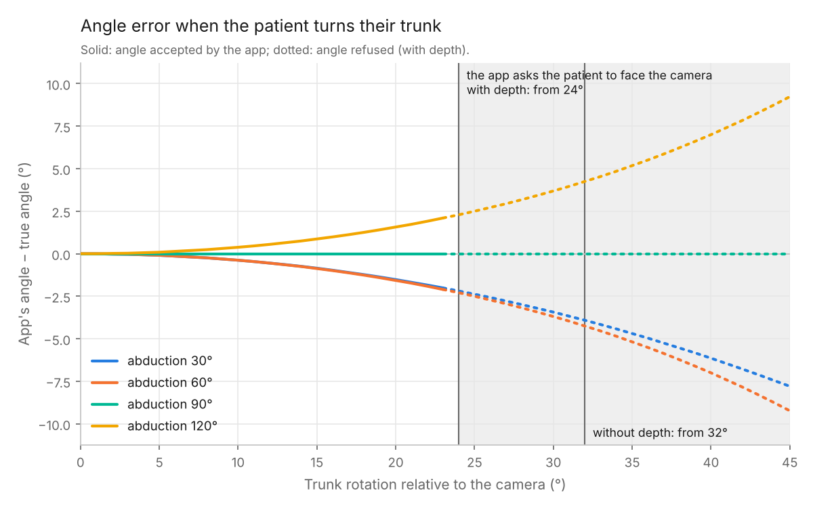
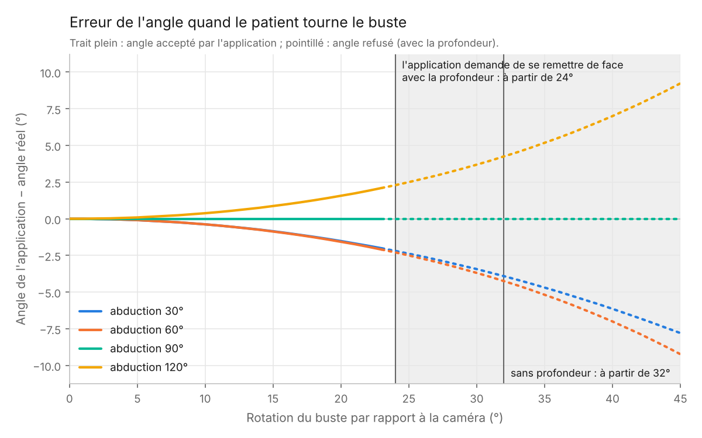

# Validation protocol: Mouvement's angle and repetition count

[English](#english) · [Français](#français)

---

## English

### 1. Aim

Measure how well Mouvement agrees with a reference instrument, on healthy volunteers first:

1. **Angle.** The shoulder abduction angle the app measures, against a universal goniometer
   (or a smartphone inclinometer, see 2.1).
2. **Counting.** The repetitions the app counts, against an observer's count.

Results are only valid for the setup and the people tested. Patients come later, and only
after the supervisor's ethics decision (section 7).

### 2. Setup

#### 2.1 Equipment

- The PC with Mouvement installed and the pose model downloaded (`python models/download_models.py`).
- The webcam used by the app, on a stable stand (no laptop lid that wobbles).
- A **universal goniometer** with 1° graduations. A smartphone inclinometer app is acceptable
  instead, strapped to the outer upper arm, but it measures the arm against gravity, not
  against the trunk: the volunteer must stay upright.
- Floor tape for the volunteer's feet and the camera stand.
- A plain wall or background, if possible.
- Printed consent forms (appendix A) and a pen; the paper log (appendix B).

#### 2.2 Camera and room

- **Camera height:** about the volunteer's chest or shoulder height (1.2–1.4 m), level, not tilted.
- **Distance:** the one patients will use. Before the study, open the app with the silhouette
  on (key G), stand a team member where their upper body fits it (green outline, about 1.3–1.6 m
  from a usual webcam), and mark that spot on the floor for every volunteer. Check that the
  head, both shoulders and both hips are in the picture, and that the elbow (and if possible
  the hand) stays in the picture with the arm raised to 120°.
- **Facing the camera:** feet and shoulders square to the camera. The app stops measuring
  from about 24° of trunk rotation (section 5).
- **Lighting:** even light from the front or the ceiling; no window behind the volunteer.
- **Clothing:** fitted, short or rolled-up sleeves, so shoulders and elbows are visible;
  no bulky jacket.
- **Nobody else in the picture during a recording.** The tool follows the closest person,
  but a second person near the volunteer can hide the arm.

#### 2.3 Roles

- **Operator** (at the keyboard): runs the tool, types the readings.
- **Examiner** (with the goniometer): positions the volunteer, reads the goniometer, and
  must **not see the app's angle**. Use `--blind` (the screen then hides it) or turn the screen
  away from the examiner.
- **Observer** (for the repetition sets): counts the repetitions without looking at the screen.
  The examiner can be the observer.

### 3. Procedure

#### 3.1 Before each volunteer

1. Explain the study; the volunteer reads and signs the consent form (appendix A), and ticks
   the video box only if they agree to video.
2. Give an **anonymous ID** (V01, V02…). Write the link between name and ID only on the paper
   consent form, kept by the supervisor, never in the files.
3. Start the tool:
   ```powershell
   python record_clip.py angles --subject V01 --shuffle --blind
   # add --save-video only if the volunteer ticked the video box
   ```
4. **Calibration:** the volunteer stands on the marks, arms relaxed along the body, still,
   for about 3 s, until the screen says *Prêt*.

#### 3.2 Held positions: 0°, 30°, 60°, 90°, 120°

For each arm (right first, then left), three rounds; in each round every position once
(`--shuffle` mixes the order of positions in each round, the same order if the session resumes):

1. The examiner guides the arm to about the target with the goniometer, in the frontal plane,
   elbow straight, thumb up, trunk upright. The goniometer then **leaves the picture**.
2. The operator presses **SPACE**: 3-second countdown, then **3 s of recording** while the
   volunteer holds still.
3. While the volunteer still holds, the examiner places the goniometer and reads the angle
   (axis on the front of the acromion, fixed arm parallel to the sternum, moving arm along
   the humerus toward the elbow), and says it aloud.
4. The operator types the reading and presses **Enter**. The tool moves to the next trial.
   **R** redoes the trial (the volunteer moved, someone walked in), **S** skips it.
5. Rest the arm for at least 10 s between trials, longer if the volunteer asks.

The reference is the angle **actually held** (the reading), not the target: being a few
degrees off the target is fine.

#### 3.3 Sets of repetitions

At the end of each arm's positions, the tool asks for one set (`--reps-sets 2` for two):

1. The volunteer does **10 repetitions at their own pace**: raise the arm sideways to about
   90°, hold about one second, lower it next to the body.
2. The operator presses **SPACE** to start, and **SPACE** again when the volunteer has finished.
3. The observer counts aloud only at the end; the operator types the count and **Enter**.

Count one repetition each time the arm rises clearly away from the body and comes back down
beside it. The app counts a repetition when the arm rises above about 32° and comes back below
about 25° (higher for a volunteer whose resting arm is already away from the body); a repetition
that doesn't reach 80° is still counted, and marked *to improve*.

#### 3.4 Volunteers and timing

- **At least 10 healthy adult volunteers**, without shoulder pain or surgery, before any patient.
- About **25 min per volunteer**: 5 min consent and setup, 15 min of held positions (30 trials),
  5 min of repetition sets. Ten volunteers fit in one afternoon with one station:

  | Time | |
  |---|---|
  | 13:30 | Set up the room, mark the floor, dry run with the team |
  | 14:00–18:15 | Volunteers V01–V10, 25 min each, with 5-minute breaks |
  | 18:15 | Copy the study folder to a USB key, run the report |

- An interrupted session resumes: run the same command with the same ID, and the tool starts
  at the first missing trial.

### 4. Data and files

Everything goes to `%APPDATA%\Mouvement\validation` (or the folder given with `--out`):

```
validation\
  trials.csv                         one row per trial attempt (see 4.1)
  V01\V01_right_hold060_t2_20261127-143512.csv    every frame of one trial (see 4.2)
  V01\V01_right_hold060_t2_20261127-143512.mp4    only with --save-video and video consent
  report\                            written by evaluate_dataset.py angles
```

No name, no image (unless the volunteer agreed to video). Back up the folder after each
session, and delete it at the end of the project as the consent form says.

#### 4.1 `trials.csv`

One row per attempt. A trial's result is its newest attempt with status `ok`.

| Column | Meaning |
|---|---|
| `trial_id` | `V01_right_hold060_t2` (subject, arm, position or `reps`, trial number) |
| `subject`, `arm`, `kind`, `target_deg`, `trial` | the same, in separate columns; `kind` is `hold` or `reps` |
| `reference_deg` | the goniometer reading (holds) |
| `observer_reps` | the observer's count (sets) |
| `app_deg` | the app's angle for the hold: median of the frames with an angle, after the first 0.5 s; empty if fewer than half the frames had an angle |
| `app_reps` | repetitions counted by the app during the set |
| `valid_frames`, `frames` | frames with an angle, frames recorded |
| `status` | `ok` (reading typed), `redo` or `skipped` |
| `model`, `camera` | pose model file, camera number |
| `recorded_at` | date and time |
| `frames_file`, `video_file` | the files of this attempt, relative to the study folder |
| `notes` | free text (empty from the tool) |

#### 4.2 Frame files

One row per camera frame of the recording:

| Column | Meaning |
|---|---|
| `frame`, `time_s` | frame number, seconds since the recording started |
| `angle_deg`, `angle_valid` | the app's angle (smoothed, as shown in the app) and 1 if there was one |
| `status`, `phase`, `reps_total`, `reference_mode` | the app's tracking status, movement phase, repetition count so far, and angle reference (`torso` or `shoulders`) |
| `n0_x` … `n32_v` | the 33 image landmarks: x and y in [0, 1] of the image, visibility |
| `w0_x` … `w32_z` | the 33 world landmarks, in metres around the hips |

Plain CSV: comma-separated, dot decimals, UTF-8.

### 5. Why the app stops measuring a turned body

The app measures the angle in the camera image, so it is exact only when the volunteer faces
the camera. `python tools/rotation_sensitivity.py` turns a synthetic body holding a known
abduction and runs each pose through the app:



- At 90° the error stays at zero (the arm is level with the shoulder); below and above, the
  error grows with the rotation, in opposite directions: about −3.7° at 30° of rotation for a
  60° abduction, −9.2° at 45°.
- The app refuses the angle and asks the patient to face the camera from **24°** of rotation
  when the pose model gives depth, and from **32°** with the width check alone (Phase 5.6), so
  what it accepts stays within about **2°** of the true angle.
- The synthetic arm stays in the body's frontal plane; real arms often move a little forward
  (the scapular plane), which is one more reason to measure real volunteers.

### 6. Analysis

```powershell
python evaluate_dataset.py angles              # French report
python evaluate_dataset.py angles --lang en    # English report
```

It writes `report\validation_report.md`, `validation_pairs.csv` and three charts:

- **Mean absolute error** and **mean bias** (app − goniometer), overall, per position and per arm.
- **Bland–Altman 95% limits of agreement** (bias ± 1.96 SD), with Bland & Altman's (2007)
  correction for several trials per volunteer.
- **ICC(2,1)**: two-way random effects, absolute agreement, single measure.
- **Repetition counting**: sets counted exactly, and repetitions counted correctly
  = 1 − Σ|app − observer| / Σ observer.
- 95% confidence intervals by resampling volunteers.

**Proposed targets, to confirm with the supervisor:** mean absolute error ≤ 5°, 95% limits of
agreement within ±10°, at least 95% of repetitions counted correctly.

### 7. Ethics and data protection

- Before testing with **patients**, ask the supervisor whether the study needs an ethics
  committee's opinion. In Morocco, research "on human beings to develop biological or medical
  knowledge" falls under law 28-13 (protection of people taking part in biomedical research),
  which requires an ethics committee's favourable opinion and an authorisation; a decree
  published on 4 May 2026 reorganised the procedure, with the AMMPS handling applications.
  Ask the same question for healthy volunteers if the faculty requires it.
- Ask whether the study's data processing must be declared to the CNDP (law 09-08 on personal
  data). Health data are sensitive data.
- Participation is voluntary; a volunteer can stop at any time without giving a reason, and
  their data are then deleted.
- Stop a trial at once if the volunteer feels pain. The app never asks anyone to push through pain.

This section lists questions to settle with the supervisor; it is not legal advice.

---

## Français

### 1. Objectif

Mesurer l'accord de Mouvement avec un instrument de référence, d'abord sur des volontaires sains :

1. **Angle.** L'angle d'abduction de l'épaule mesuré par l'application, comparé à un goniomètre
   universel (ou à un inclinomètre de smartphone, voir 2.1).
2. **Comptage.** Les répétitions comptées par l'application, comparées au comptage d'un observateur.

Les résultats ne valent que pour l'installation et les personnes testées. Les patients viennent
ensuite, et seulement après la décision de l'encadrant sur l'éthique (section 7).

### 2. Installation

#### 2.1 Matériel

- Le PC avec Mouvement et le modèle de pose téléchargé (`python models/download_models.py`).
- La webcam utilisée par l'application, sur un support stable.
- Un **goniomètre universel** gradué au degré. Un inclinomètre de smartphone fixé sur la face
  externe du bras convient aussi, mais il mesure le bras par rapport à la verticale, pas au
  tronc : le volontaire doit rester bien droit.
- Du ruban adhésif pour marquer au sol les pieds et le pied de la caméra.
- Un mur ou un fond uni si possible.
- Les formulaires de consentement imprimés (annexe A), un stylo, la fiche de suivi (annexe B).

#### 2.2 Caméra et salle

- **Hauteur de la caméra :** environ à hauteur de poitrine ou d'épaules (1,2 à 1,4 m), droite, non inclinée.
- **Distance :** celle des patients. Avant l'étude, ouvrez l'application avec la silhouette
  (touche G), placez un membre de l'équipe pour que le haut de son corps y rentre (contour vert,
  environ 1,3 à 1,6 m d'une webcam courante) et marquez cet endroit au sol pour tous les
  volontaires. Vérifiez que la tête, les deux épaules et les deux hanches sont dans l'image, et
  que le coude (et si possible la main) reste dans l'image bras levé à 120°.
- **Face à la caméra :** pieds et épaules face à l'objectif. L'application arrête de mesurer à
  partir d'environ 24° de rotation du buste (section 5).
- **Éclairage :** lumière homogène de face ou du plafond ; pas de fenêtre derrière le volontaire.
- **Tenue :** près du corps, manches courtes ou relevées, épaules et coudes visibles ; pas de veste épaisse.
- **Personne d'autre dans l'image pendant un enregistrement.** L'outil suit la personne la plus
  proche, mais une deuxième personne à côté du volontaire peut cacher le bras.

#### 2.3 Rôles

- **Opérateur** (au clavier) : lance l'outil, saisit les valeurs.
- **Examinateur** (au goniomètre) : place le volontaire, lit le goniomètre, et **ne doit pas
  voir l'angle de l'application**. Utilisez `--blind` (l'écran le masque) ou tournez l'écran.
- **Observateur** (pour les séries de répétitions) : compte sans regarder l'écran.
  L'examinateur peut être l'observateur.

### 3. Déroulement

#### 3.1 Avant chaque volontaire

1. Expliquez l'étude ; le volontaire lit et signe le formulaire de consentement (annexe A), et
   coche la case vidéo seulement s'il l'accepte.
2. Donnez un **identifiant anonyme** (V01, V02…). Le lien entre le nom et l'identifiant n'est
   écrit que sur le formulaire papier, gardé par l'encadrant, jamais dans les fichiers.
3. Lancez l'outil :
   ```powershell
   python record_clip.py angles --subject V01 --shuffle --blind
   # ajoutez --save-video seulement si le volontaire a coché la case vidéo
   ```
4. **Calibration :** le volontaire se tient sur les marques, bras relâchés le long du corps,
   immobile, environ 3 s, jusqu'à ce que l'écran affiche *Prêt*.

#### 3.2 Positions tenues : 0°, 30°, 60°, 90°, 120°

Pour chaque bras (droit puis gauche), trois tours ; à chaque tour, chaque position une fois
(`--shuffle` mélange l'ordre des positions à chaque tour, le même si la séance reprend) :

1. L'examinateur guide le bras jusqu'à la cible environ avec le goniomètre, dans le plan
   frontal, coude tendu, pouce vers le haut, tronc droit. Le goniomètre **sort ensuite de l'image**.
2. L'opérateur appuie sur **ESPACE** : compte à rebours de 3 s, puis **3 s d'enregistrement**
   pendant que le volontaire tient la position, immobile.
3. Le volontaire tient toujours ; l'examinateur pose le goniomètre et lit l'angle (axe sur la
   face antérieure de l'acromion, branche fixe parallèle au sternum, branche mobile le long de
   l'humérus vers le coude) et l'annonce à voix haute.
4. L'opérateur saisit la valeur et appuie sur **Entrée**. L'outil passe à l'essai suivant.
   **R** refait l'essai (le volontaire a bougé, quelqu'un est passé), **S** le passe.
5. Le bras se repose au moins 10 s entre deux essais, plus si le volontaire le demande.

La référence est l'angle **réellement tenu** (la lecture), pas la cible : quelques degrés
d'écart avec la cible ne posent aucun problème.

#### 3.3 Séries de répétitions

À la fin des positions de chaque bras, l'outil demande une série (`--reps-sets 2` pour deux) :

1. Le volontaire fait **10 répétitions à son rythme** : lever le bras sur le côté jusqu'à
   environ 90°, tenir environ une seconde, redescendre le long du corps.
2. L'opérateur appuie sur **ESPACE** pour commencer, puis de nouveau sur **ESPACE** à la fin.
3. L'observateur ne donne son comptage qu'à la fin ; l'opérateur le saisit, puis **Entrée**.

Comptez une répétition chaque fois que le bras s'écarte nettement du corps puis redescend le
long du corps. L'application compte une répétition quand le bras dépasse environ 32° puis
redescend sous environ 25° (un peu plus haut si le bras au repos est déjà écarté du corps) ;
une répétition qui n'atteint pas 80° est comptée quand même, et marquée « à améliorer ».

#### 3.4 Volontaires et durée

- **Au moins 10 volontaires adultes sains**, sans douleur ni chirurgie de l'épaule, avant tout patient.
- Environ **25 min par volontaire** : 5 min de consentement et d'installation, 15 min de
  positions (30 essais), 5 min de séries. Dix volontaires tiennent en un après-midi avec un poste :

  | Heure | |
  |---|---|
  | 13 h 30 | Installation de la salle, marques au sol, essai à blanc avec l'équipe |
  | 14 h 00–18 h 15 | Volontaires V01 à V10, 25 min chacun, pauses de 5 min |
  | 18 h 15 | Copie du dossier de l'étude sur une clé USB, rapport |

- Une séance interrompue reprend : relancez la même commande avec le même identifiant, l'outil
  repart au premier essai manquant.

### 4. Données et fichiers

Tout va dans `%APPDATA%\Mouvement\validation` (ou dans le dossier donné par `--out`) ;
le détail des colonnes est en 4.1 et 4.2 de la version anglaise :

- `trials.csv` : une ligne par tentative d'essai (lecture du goniomètre ou comptage de
  l'observateur, angle ou comptage de l'application, statut `ok`, `redo` ou `skipped`) ;
- un fichier par essai dans le dossier du volontaire : chaque image enregistrée, avec l'angle de
  l'application et les 33 points du corps (image et 3D) ;
- une vidéo par essai seulement avec `--save-video` et le consentement vidéo.

Ni nom, ni image (sauf accord vidéo). Sauvegardez le dossier après chaque séance et supprimez-le
à la fin du projet comme l'indique le formulaire de consentement.

### 5. Pourquoi l'application ne mesure plus un buste tourné

L'application mesure l'angle dans l'image : il n'est exact que si le volontaire est face à la
caméra. `python tools/rotation_sensitivity.py` fait tourner un corps de synthèse qui tient une
abduction connue et passe chaque pose dans l'application :



- À 90°, l'erreur reste nulle (le bras est à hauteur de l'épaule) ; en dessous et au-dessus,
  elle grandit avec la rotation, en sens opposés : environ −3,7° à 30° de rotation pour une
  abduction de 60°, −9,2° à 45°.
- L'application refuse l'angle et demande de se remettre de face à partir de **24°** de rotation
  quand le modèle donne la profondeur, et de **32°** avec la seule vérification de largeur
  (phase 5.6) : ce qu'elle accepte reste à environ **2°** de l'angle réel.
- Le bras de synthèse reste dans le plan frontal du corps ; un vrai bras part souvent un peu en
  avant (plan de la scapula), une raison de plus de mesurer de vrais volontaires.

### 6. Analyse

```powershell
python evaluate_dataset.py angles              # rapport en français
python evaluate_dataset.py angles --lang en    # rapport en anglais
```

Le rapport `report\validation_report.md`, le fichier `validation_pairs.csv` (ouvrable dans
Excel) et trois graphiques donnent :

- l'**erreur absolue moyenne** et le **biais moyen** (application − goniomètre), en tout, par
  position et par bras ;
- les **limites d'accord à 95 % de Bland–Altman** (biais ± 1,96 écart-type), avec la correction
  de Bland & Altman (2007) pour plusieurs essais par volontaire ;
- l'**ICC(2,1)** : deux facteurs aléatoires, accord absolu, mesure unique ;
- le **comptage des répétitions** : séries exactes, et répétitions bien comptées
  = 1 − Σ|application − observateur| / Σ observateur ;
- des intervalles de confiance à 95 % par rééchantillonnage des volontaires.

**Cibles proposées, à confirmer avec l'encadrant :** erreur absolue moyenne ≤ 5°, limites
d'accord à 95 % dans ±10°, au moins 95 % des répétitions bien comptées.

### 7. Éthique et protection des données

- Avant de tester avec des **patients**, demandez à l'encadrant si l'étude doit passer devant un
  comité d'éthique. Au Maroc, la recherche « organisée et pratiquée sur l'être humain en vue de
  développer les connaissances biologiques ou médicales » relève de la loi 28-13 relative à la
  protection des personnes participant aux recherches biomédicales, qui exige l'avis favorable
  d'un comité d'éthique et une autorisation ; un décret publié au Bulletin officiel du 4 mai 2026
  a réorganisé la procédure et confié l'instruction des demandes à l'AMMPS. Posez la même question
  pour les volontaires sains si la faculté l'exige.
- Demandez si le traitement des données de l'étude doit être déclaré à la CNDP (loi 09-08 sur
  les données personnelles). Les données de santé sont des données sensibles.
- La participation est volontaire ; un volontaire peut arrêter à tout moment sans se justifier,
  et ses données sont alors supprimées.
- Arrêtez l'essai immédiatement si le volontaire a mal. L'application ne demande jamais de forcer
  malgré la douleur.

Cette section liste des questions à régler avec l'encadrant ; ce n'est pas un avis juridique.

---

## Annexe A : formulaire de consentement

> Modèle à faire relire par l'encadrant. Les champs entre crochets sont à compléter.

**Étude de validation de l'application Mouvement (rééducation de l'épaule)**
Responsable : [nom de l'étudiant], cycle ingénieur « Digital en Santé », UM6SS, Casablanca.
Encadrant : [nom, fonction, contact].

**But de l'étude.** Vérifier si l'angle de l'épaule mesuré par l'application Mouvement avec une
simple webcam correspond à la mesure d'un goniomètre, et si l'application compte bien les
mouvements.

**Ce que l'on vous demande.** Environ 25 minutes : lever le bras sur le côté à plusieurs
hauteurs et tenir 3 secondes à chaque fois, puis faire deux séries de 10 mouvements, devant une
webcam. Un examinateur mesure l'angle avec un goniomètre posé sur votre bras.

**Risques.** Ceux d'un exercice doux de l'épaule. Vous pouvez faire une pause ou arrêter à tout
moment. Signalez toute douleur : l'essai s'arrête aussitôt.

**Données recueillies.** Un identifiant anonyme (par exemple V07), les positions de points du
corps calculées par l'application à partir des images de la caméra, les angles et les comptages.
**Aucune image n'est conservée**, sauf si vous cochez la case vidéo ci-dessous. Votre nom
n'apparaît que sur ce formulaire, conservé par l'encadrant, séparé des données.

**Conservation.** Sur l'ordinateur de l'étude, accessible à l'étudiant et à l'encadrant, jusqu'au
[date de fin du projet], puis supprimées. Les résultats publiés (rapport, soutenance) ne
contiennent que des chiffres d'ensemble, sans identifiant.

**Vos droits.** Votre participation est volontaire. Vous pouvez la retirer à tout moment, sans
justification ni conséquence ; vos données sont alors supprimées. Vous pouvez demander à y
accéder ou à les faire corriger auprès de [contact].

☐ J'ai lu ces informations, j'ai pu poser mes questions, et j'accepte de participer.

☐ J'accepte en plus que des **vidéos** de mes mouvements soient enregistrées pour l'étude
(facultatif ; sans cette case, aucune vidéo n'est gardée).

Nom et prénom : ____________________  Identifiant attribué : V____

Date : ____ / ____ / ________  Signature du volontaire : ____________________

Signature du responsable : ____________________

## Annexe B : fiche de suivi d'une séance

| Identifiant | Date | Bras dominant | Caméra (n°, distance) | Vidéo (oui/non) | Remarques (essais refaits, gêne, douleur, éclairage…) |
|---|---|---|---|---|---|
| V01 | | | | | |
| V02 | | | | | |
| … | | | | | |
